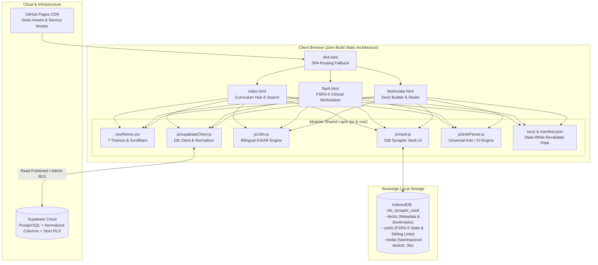

# MedicineBank Data & Clinical Spaced Repetition Workstation

[](LICENSE)
[](https://data.medicinebank.org)
[](https://github.com/open-spaced-repetition/fsrs4anki)
[](https://katex.org/)
[](https://sql.js.org/)
[](manifest.json)
[](schema.sql)

An offline-first, clinical-grade medical curriculum portal and active-recall spaced repetition workstation designed for medical scholars, clinicians, and licensing candidates.

Live Production URL: **[https://data.medicinebank.org](https://data.medicinebank.org)**

---

## 1. System Architecture & Topology

MedicineBank is engineered as a **zero-build, static-compatible, sovereign web application** fully runnable directly on GitHub Pages without requiring a backend runtime build step. Core utilities are modularized into native ES modules and shared styles.



---

## 2. Key Capabilities & Modular Components

### 🎨 Modular Design System (`css/theme.css`)
- **7 Clinical Color Themes**: Dark (Obsidian), Light (Clinical Ivory), Maroon, Blue, Orange, Champagne, and Brown.
- **Instant FOUC Prevention**: Fast inline head scripts inspect `localStorage.getItem('mb_theme')` and set `html[data-theme]` before rendering begins.
- **Custom Scrollbars**: Modern, theme-reactive scrollbars eliminating legacy OS stepper arrows.

### 🌐 Shared Bilingual Localization (`js/i18n.js`)
- Comprehensive clinical dictionary covering medical curriculum terminology in both English and Arabic.
- Automatic bidirectional layout switching (`dir="ltr"` / `dir="rtl"`) and dynamic `[data-en]` / `[data-ar]` attribute binding.

### 🛡️ Sovereign IndexedDB Manager (`js/vault.js`)
- Sovereign client-side store (`mb_synaptic_vault`, schema v3) unifying `decks`, `cards`, and `media`.
- **Zero Cross-Deck Media Collisions**: Enforces composite namespacing (`${deckId}:::${filename}`) so identical filenames across multiple decks never collide or overwrite each other.
- **Active Memory Cache Eviction**: `revokeAndClearMediaCache` completely revokes existing `blob:` URLs when switching decks to eliminate memory leaks.
- **Stop Sign Session Bookmarks**: Automatically records progress and renders exact resume badges (e.g., `🛑 Resuming at Card 14/45`).

### 📦 Universal Anki & Media Parser (`js/ankiParser.js`)
- Universal parser supporting Anki 2.1 standard SQLite (`collection.anki2`, `collection.anki21`) and compressed Anki 2.1.50+ (`collection.anki21b` via `fzstd`).
- Full support for Protobuf media manifests and JSON media maps.
- **Multi-Cloze Sibling Synthesis**: Extracts all unique clozes (`{{c1::...}}`, `{{c2::...}}`, etc.) and produces individual study cards with back-face answer reveals and custom hint formatting (`{{c1::answer::hint}}`).
- **Image Occlusion (IO) Overlays**: Renders SVG mask rects (`.io-box`, `.qshape`, `.io-revealed`) for AnKing / First Aid clinical image occlusion cards.

### 🧠 True FSRS-5 Neural Scheduler
- Authentic 19-parameter weight vector ($w_0–w_{18}$).
- Continuous retrievability decay formula:
  $$R(t, S) = \left(1 + \text{factor} \cdot \frac{t}{S}\right)^{-0.5} \quad \text{where } \text{factor} = \frac{19}{81} \approx 0.2345679$$
- **Configurable Target Retention**: User-selectable retention targets from $70\%$ to $97\%$ with adaptive interval scaling.
- **Intra-Session Queue Recycling**: Lapsed cards rated **Again** re-enter the end of the active session queue until mastered.
- **Daily Sibling Burying**: Reviewing a card buries its sibling cards (e.g., related cloze deletions or reversed variants) until the next calendar day, preventing artificial recall cueing. Full Undo (`Z`) unburies siblings cleanly.

### 🔒 Database Normalization & Security Hardening (`schema.sql`)
- **Normalized Columns**: Directly extracts `module_code`, `subject_name`, `semester`, and `card_count` out of legacy JSON strings in `caption`.
- **Compound Hierarchy Index**: Adds `idx_materials_hierarchy` on `(module_code, subject_name, semester)` for lightning-fast catalog filtering.
- **Strict Row-Level Security (RLS)**: Anonymous public users are limited to `SELECT` on published rows. All mutations (`INSERT`, `UPDATE`, `DELETE`) require authenticated admin/editor privileges via the `is_admin_or_editor()` helper.
- **Zero-Plaintext Admin Secrets**: Eliminates hardcoded plaintext credentials from client scripts, enforcing SHA-256 cryptographic verification for admin mode unlocking.

### 📱 PWA & Offline Sovereignty (`sw.js` & `manifest.json`)
- Complete **Stale-While-Revalidate** Service Worker caching HTML, CSS, JS, fonts, and vendor CDNs.
- Standalone PWA installability with clinical theme colors and medical icons. Students can launch the app, load downloaded decks from `mb_synaptic_vault`, and review cards anywhere without network connectivity.

---

## 3. Keyboard & Gesture Controls (`flash.html`)

| Control | Action | Details |
| :--- | :--- | :--- |
| `Space` / `Enter` | **Reveal / Grade** | Flips card if hidden; grades "Good" if already revealed |
| `1` / Swipe Left (←) | **Again** | Lapsed card; re-queued into intra-session drill |
| `2` / Swipe Down (↓) | **Hard** | Challenging recall; shorter stability interval |
| `3` / Swipe Right (→) | **Good** | Successful recall; standard FSRS-5 exponential expansion |
| `4` / Swipe Up (↑) | **Easy** | Immediate mastery; maximum stability bonus |
| `Z` | **Undo** | Reverts rating and restores previous card state & unburies siblings |
| `R` | **Replay Audio** | Replays attached medical pronunciation or heart sound audio clip |
| `0` | **Reset Zoom** | Resets image zoom and pan to 100% |
| `B` | **Browse Deck** | Opens deck search and card browser modal |
| `F` | **Focus Mode** | Toggles fullscreen distraction-free study station |
| `Esc` | **Close** | Dismisses modals, lightbox zoom, or search panels |

---

## 4. Local Development & Testing

This project requires **zero build tools** or compilers. All code runs as native web standards directly in modern browsers.

### Running Locally
```bash
# Clone the repository
git clone https://github.com/l81e/Data.git
cd Data

# Launch any local static web server
python -m http.server 8000
# Open http://localhost:8000
```

### Running the Verification Test Suite
Ensure Node.js (v18+) is installed. Run the comprehensive automated verification suites:
```bash
# Run comprehensive verification suite (673 checks across 41 suites)
node test-verification.mjs

# Run empirical challenger stress test (107 adversarial checks)
node test-challenger-final-stress.mjs
```

---

## 5. Directory Structure

```text
├── index.html                   # Modular Curriculum Explorer & Search
├── flash.html                   # Clinical Spaced Repetition Workstation
├── flashmake.html               # Visual Deck Builder & .apkg Studio
├── 404.html                     # GitHub Pages SPA Router & Redirector
├── schema.sql                   # Production Supabase DDL, Schema & RLS
├── manifest.json                # PWA Web App Manifest
├── sw.js                        # Sovereign Stale-While-Revalidate Service Worker
├── css/
│   └── theme.css                # Universal Design System (7 Themes + Scrollbars)
├── js/
│   ├── ankiParser.js            # Universal Anki 2.1/2.1.50+ & Image Occlusion Parser
│   ├── i18n.js                  # Shared Bilingual English/Arabic Engine
│   ├── supabaseClient.js        # Supabase Client & Database Normalizer
│   └── vault.js                 # Sovereign IndexedDB Vault Manager
├── test-verification.mjs        # 41-Suite Automated Regression & Verification Gate
├── test-challenger-final-stress.mjs # 107-Point Empirical Stress Harness
└── README.md                    # System Documentation & Architecture Guide
```

---

## 6. License
Licensed under the [MIT License](LICENSE).
Medical students, clinical educators, and software engineers are free to fork, customize, and extend.
